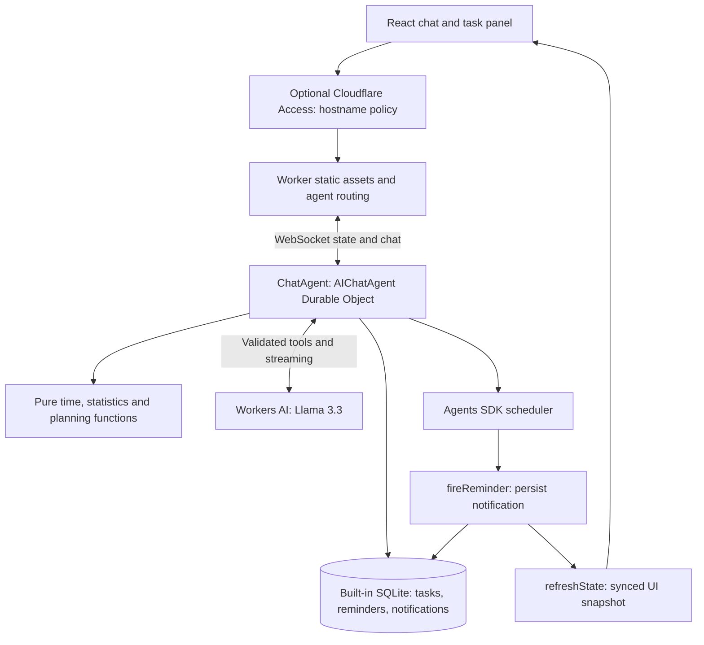

# Personal Todo Agent on Cloudflare

**[Open the live demo](https://todo-agent.nasta-butok.workers.dev)**

A single-user todo assistant for adding, editing, completing, delegating and postponing tasks through chat. It persists reminders and notifications, shows a live task panel, and proposes daily plans from completion history and corrected estimates. Brain dumps become tasks only after conversational confirmation.

## Public application demo

The current deployment is intentionally public for a Cloudflare application. All visitors share the default task list and chat instance, and inference uses the same Free allowance as local remote development. Use fictional demo data. Access instructions below are an optional private-deployment alternative; they have not been applied to the public demo.

## Demo

_Demo GIF placeholder: record task creation → reminder → daily plan → confirmed brain dump._

## Architecture



The UI reads the agent state rather than maintaining another task store. SQLite migrations run on agent startup; chat is persisted by AIChatAgent. The starter's React, Kumo and Tailwind styling remains in place. This is a single-user demo: the client uses the default instance, with no server-side instance restriction or multitenancy isolation.

## Product decisions

- **Reversible removal:** no hard-delete tool; drop and reopen preserve task history.
- **Code owns calculations:** pure functions compute dates, durations, postponement counts, completion statistics and estimate corrections. IDs come from `crypto.randomUUID()`. SQL selects the relevant records; the model chooses tools and explains their results.
- **Cold-start threshold:** fewer than 10 completed tasks means no pattern claims. Per-kind median estimate ratios require at least five estimate/actual pairs; corrections are clamped to 0.5–3.0. Unknown estimates stay unknown.
- **Honest planning windows:** local-hour history describes preferences; code supplies remaining windows so the model can distinguish a passed morning from today's availability. Plans do not mutate tasks or deadlines.
- **Persisted reminders:** notification rows survive a closed browser. Completing or dropping a task cancels pending reminders with persisted guards. Native browser notifications are optional; in-app banners work independently.
- **Confirm brain dumps:** show numbered candidates with owners and deadlines, ask one focused clarification, then insert only confirmed items. Batches contain 1–30 tasks, inserted sequentially with `source='braindump'`; partial failures are returned. No duplicate detection or batch transaction is included. Candidate extraction and item selection use the prompt. A turn guard disables preview tools and blocks batch execution without a recognized explicit confirmation after a candidate offer; this is not a persisted approval system.
- **Dashboard-managed protection:** private deployment relies on Cloudflare Access; the current public demo has no authentication. There is no application JWT validation or `auth.ts`.

## Run locally

Use Node.js 24 (developed with 24.13.0), npm, and a Cloudflare account with Workers AI access. From the repository root:

```sh
npm ci
npx wrangler login
npx wrangler whoami
npx tsc --noEmit
npm test
npm run dev
```

Open the localhost URL printed by Vite. Local development uses remote Workers AI (`AI.remote: true`), so authentication and network access are required and inference uses your account's allowance. The configured model is `@cf/meta/llama-3.3-70b-instruct-fp8-fast`; the starter's paid-only model was replaced with user approval. Free-plan limits can interrupt chat; no paid upgrade is required by this project.

No `.dev.vars` file is needed for ordinary local use. `DEV_AUTH_BYPASS="true"` is only a development seed gate in this reduced version; it does not implement authentication. Never set it in deployed variables or commit `.dev.vars`. No `ACCESS_AUD`, `ACCESS_TEAM_DOMAIN` or `ALLOWED_EMAIL` Worker variables are required.

### Optional demo history

For a new local database, temporarily put `DEV_AUTH_BYPASS="true"` in ignored `.dev.vars`, restart local dev, and invoke the agent's `seedDemoData` callable through an SDK client or its WebSocket RPC protocol. It is not an LLM tool or a UI button. For example, this Node 24 command targets the default local Vite port; replace the port if Vite prints another one:

```sh
node --input-type=module <<'JS'
const socket = new WebSocket('ws://localhost:5173/agents/chat-agent/default');
const timeout = setTimeout(() => { socket.close(); process.exitCode = 1; }, 15000);
socket.addEventListener('open', () => socket.send(JSON.stringify({
  type: 'rpc', id: 'demo-seed', method: 'seedDemoData', args: []
})));
socket.addEventListener('message', ({data}) => {
  const result = JSON.parse(String(data));
  if (result.id !== 'demo-seed') return;
  console.log(result);
  clearTimeout(timeout);
  socket.close();
});
JS
```

The seed adds 40 completed examples and two labeled open tasks. An idempotence marker prevents reseeding. Remove the flag and restart afterward; the seeded rows remain. Local data in `.wrangler/` is separate from deployed data and is not uploaded by deployment.

### Checks and sample conversations

`npx tsc --noEmit` and `npm test` are the reduced spec's completion checks. There are now 69 tests, including regression coverage added after production failures. Earlier live checks covered core mutations, persisted reminders, mobile layout, low-history planning and seeded planning. After production validation errors, local task creation passed without an error card. Final preview/confirmation, reminder and planning regressions remain live-unverified because the account exhausted its daily Free allowance.

Three manual messages for the final smoke check:

1. “Add release checklist, priority 1, admin, estimate 30 minutes, no deadline.”
2. “Brain dump: I need to review the proposal, and Alex needs to send the invoice. Neither has a deadline. Show candidates first.” Then “Add both.”
3. “Plan my day.” A fresh deployment should acknowledge insufficient completion history.

## Deploy — user-run steps

No deployment or dashboard configuration has been performed by the coding agent.

1. Review `wrangler.jsonc`: Worker name `todo-agent`, `ChatAgent` SQLite Durable Object binding and migration, remote AI binding, and static asset configuration. Sign in with `npx wrangler login` and confirm the intended account with `npx wrangler whoami`.
2. Prepare hostname-based Access as described below for the hostname you intend to use. Keep private task data out of the app until protection has been verified.
3. From the repository root, run:

   ```sh
   npm ci
   npx tsc --noEmit
   npm test
   npm run deploy
   ```

   `npm run deploy` builds with Vite before running `wrangler deploy`, so Wrangler uses the generated build configuration. A bare `wrangler deploy` from unbuilt source does not replace the Vite build step. The command provisions the configured Worker and Durable Object migration in your account.

4. Finish the Access hostname entries using the actual deployment URL. Protect or disable alternate hostnames and preview URLs before entering personal data.
5. Verify Access in a signed-out/private window: the root page and `/agents/chat-agent/default` must require authentication. Sign in as the allowed identity, open the app, and confirm chat reaches Connected. A different identity must be denied. Then run the three smoke messages above.

### Cloudflare Access setup

Use **hostname-based** Access: Worker-level Access currently rejects WebSocket upgrades. Protect each enabled hostname, including `workers.dev`, custom domains and any previews, or disable unused endpoints. See [Workers Access guidance](https://developers.cloudflare.com/workers/configuration/cloudflare-access/).

In Zero Trust, open **Access controls → Applications → Create new application → Self-hosted and private**. Add the public hostname for the app (use custom input when needed); leave the path empty to protect the entire host. Add an **Allow** policy with **Include → Emails** restricted to your own address, select an identity provider or email one-time PIN, choose a session duration, and save. Avoid an Everyone or Bypass policy. See [self-hosted application setup](https://developers.cloudflare.com/cloudflare-one/access-controls/applications/http-apps/self-hosted-public-app/).

The app has no origin JWT check; an uncovered hostname exposes its agent routes. Localhost is unprotected for development. Keep this a single-user demo behind the configured Access application.

## Known limitations

- The model sometimes sends numeric strings or optional nulls. A narrow repair hook normalizes known representation errors before strict validation. Other malformed calls can still fail; historical error cards remain in chat.
- Recognized English statistics-only requests restrict tool availability to completion stats. Other wording may still confuse model intent.
- A stream adapter removes duplicated native/OpenAI text and tool representations; regression coverage includes numeric mirrors and UTF-8.
- Opaque local internal errors and browser reload stalls occurred; their root causes remain unknown. Successful data checks do not establish that these are resolved.
- The original install reported 24 dependency audit findings (including high/critical); dependency paths have not been triaged. There is no claim of a completed security audit.
- Daily Free AI quota is currently exhausted; further inference must wait for available quota. Chat now displays a quota-specific error.
- Native OS notification delivery, deployed Access and final production fixes have not been verified. Full observations and workarounds are in [FRICTION_LOG.md](FRICTION_LOG.md).

## What I'd build next

AI Gateway for inference observability and cost controls; stronger schema adherence and useful tool errors; server-enforced brain-dump confirmation and retry idempotency; dependency audit remediation; export/backup; production Access and WebSocket integration checks. AI Gateway and additional authentication code were explicitly excluded from this delivery.
