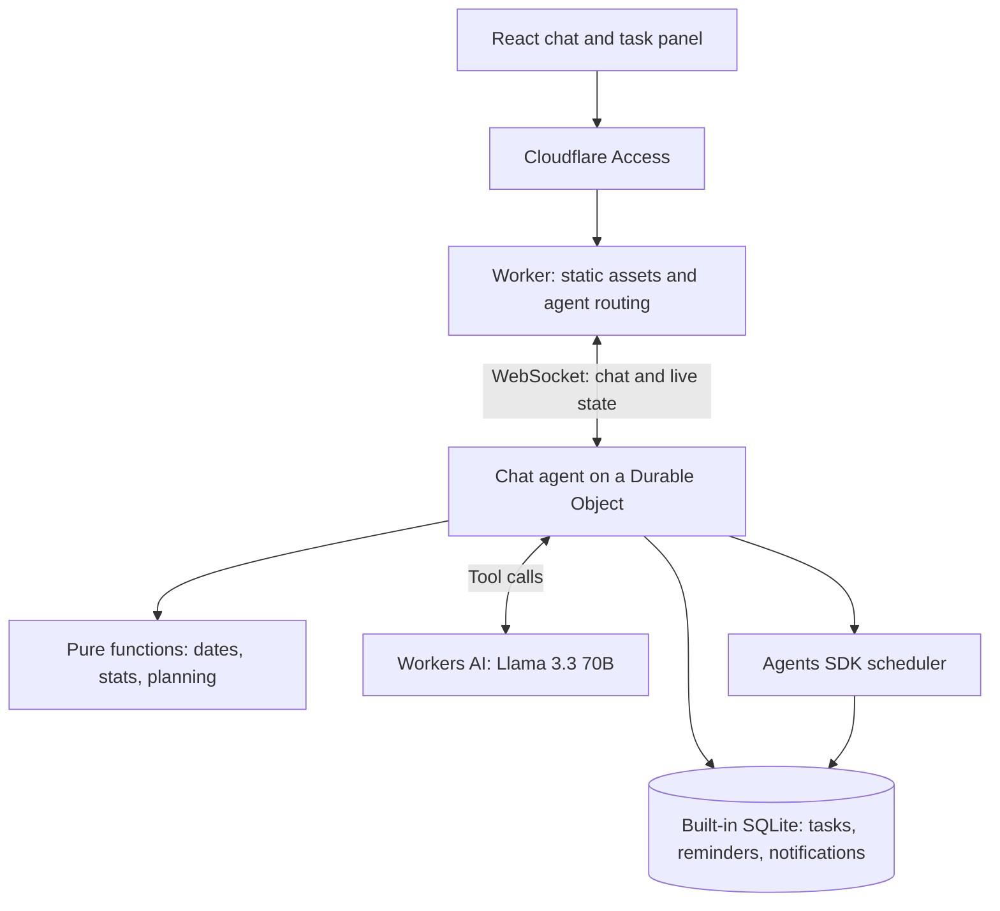

# Todo Agent

A personal todo assistant you talk to instead of filling in forms.

I wanted a todo app that works the way I do. I wanted to type _"move the report to Friday and remind me on Thursday"_ and have it done, and I wanted the app to notice that I always underestimate deep work. Nothing I tried quite did that, so I built my own: a chat agent on Cloudflare that manages my tasks, sets reminders, turns messy meeting notes into tasks, and learns from when I actually get things done.

<!-- Add a screenshot or short GIF here: add a task → set a reminder → "plan my day" -->

## What it does

- **Manage tasks by chatting.** Add, edit, complete, delegate, postpone, drop and reopen tasks in plain language. A live task panel updates as you talk.
- **Reminders that don't get lost.** "Remind me about X tomorrow at 9" schedules a wake-up for the agent. The reminder is saved even if the browser is closed and shows up the next time you open the app.
- **Brain dump → tasks.** Paste meeting notes or a messy list. The agent proposes numbered tasks with owners and deadlines, asks one clarifying question, and only adds the ones you confirm.
- **Plan my day.** Once there's enough history, the agent looks at when you usually finish each kind of work and how far off your estimates tend to be, then suggests a plan for the rest of the day.

## How it's built

Each user gets their own agent, built with the [Cloudflare Agents SDK](https://developers.cloudflare.com/agents/). Under the hood the agent is a Durable Object, so it keeps its own SQLite database, can schedule its own wake-ups for reminders, and pushes live updates to the browser over a WebSocket. There's no separate server, database or job queue to run.



**Stack:** Cloudflare Workers, Agents SDK, Durable Objects (SQLite), Workers AI, React + Vite, Vitest (69 tests).

I built it with AI coding agents working from a phased spec ([SPEC.md](SPEC.md)). I owned the product decisions, scope and testing, and [PROGRESS.md](PROGRESS.md) and the commit history show how it came together phase by phase.

## Product decisions

- **The model never does maths.** Dates, durations, postponement counts and estimate corrections are computed in tested code. The LLM only decides which tool to call and explains the result. That's what keeps "next Friday" correct across time zones and daylight-saving changes.
- **No hard delete.** Dropping a task keeps its history, so anything can be reopened.
- **No guessing without data.** The planner makes no claims about your habits until you've completed at least 10 tasks, and estimate corrections are capped so one odd day can't skew them.
- **Confirm before creating.** A brain dump never creates tasks until you say which ones you want.
- **Reminders survive a closed tab.** Notifications are stored, not just pushed, and completing a task cancels its pending reminders.

## What I'd build next

- AI Gateway for logging, caching and cost limits on model calls
- Stricter tool-call validation with clearer error messages
- Export and backup of tasks
- A short onboarding flow, so the planner is useful from day one

## Notes from building it

[FRICTION_LOG.md](FRICTION_LOG.md) collects the places where the docs, types or tooling behaved differently than expected, with workarounds. For example, Worker-level Access doesn't support WebSocket upgrades, and the starter template's default model isn't available on the Workers Free plan.

**Known limitations:** it's a single-user app protected by Cloudflare Access, with no auth code of its own. The model occasionally sends malformed tool arguments, and a small repair step catches the common cases. Dependencies haven't been through a security audit.

---

## Run locally

Requires Node.js 24 and a Cloudflare account with Workers AI access.

```sh
npm ci
npx wrangler login
npx tsc --noEmit
npm test
npm run dev
```

Open the localhost URL Vite prints. Local dev uses remote Workers AI (`@cf/meta/llama-3.3-70b-instruct-fp8-fast`), so you need to be logged in, and requests count against your account's AI allowance. No `.dev.vars` file is needed for normal use.

### Demo history (optional)

To try the planner without weeks of real data, put `DEV_AUTH_BYPASS="true"` in `.dev.vars` (it's git-ignored), restart dev, and call the `seedDemoData` callable:

```sh
node --input-type=module <<'JS'
const socket = new WebSocket('ws://localhost:5173/agents/chat-agent/default');
const timeout = setTimeout(() => { socket.close(); process.exitCode = 1; }, 15000);
socket.addEventListener('open', () => socket.send(JSON.stringify({
  type: 'rpc', id: 'demo-seed', method: 'seedDemoData', args: []
})));
socket.addEventListener('message', ({data}) => {
  const result = JSON.parse(String(data));
  if (result.id !== 'demo-seed') return;
  console.log(result);
  clearTimeout(timeout);
  socket.close();
});
JS
```

This adds 40 completed example tasks and two open ones, and only runs once. Remove the flag and restart afterwards. Never set it in deployed variables.

### Try these messages

1. "Add release checklist, priority 1, admin, estimate 30 minutes, no deadline."
2. "Brain dump: I need to review the proposal, and Alex needs to send the invoice. Neither has a deadline. Show candidates first." Then: "Add both."
3. "Plan my day."

## Deploy

1. Check `wrangler.jsonc` (Worker `todo-agent`, the `ChatAgent` Durable Object binding and migration, the AI binding, static assets), then run `npx wrangler login`.
2. Run `npm ci && npx tsc --noEmit && npm test && npm run deploy`. `npm run deploy` builds with Vite first, so use it rather than a bare `wrangler deploy`.
3. Protect the app with Cloudflare Access before adding real data (see below).

### Cloudflare Access

Use **hostname-based** Access. Worker-level Access currently rejects WebSocket upgrades, which this app relies on. In Zero Trust, go to **Access controls → Applications → Create new application → Self-hosted and private**, add the app's hostname with an empty path, and add an **Allow** policy limited to your own email. Protect or disable every other hostname, including `workers.dev` and preview URLs. Then check in a private window that both `/` and `/agents/chat-agent/default` require sign-in. See [Workers Access guidance](https://developers.cloudflare.com/workers/configuration/cloudflare-access/) and [self-hosted application setup](https://developers.cloudflare.com/cloudflare-one/access-controls/applications/http-apps/self-hosted-public-app/).
